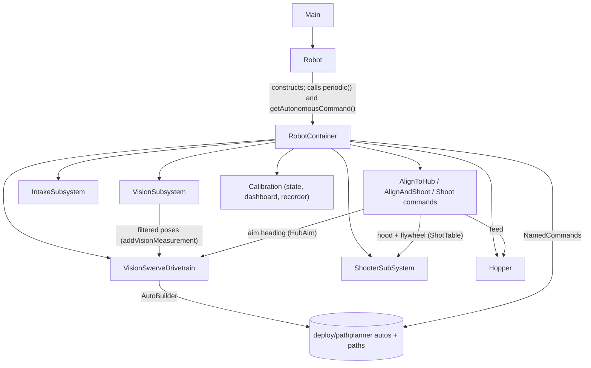

# Robot2026 Code Map

FRC 2026 robot code for Arc-imedes: a command-based WPILib Java project (GradleRIO 2026.2.1,
Java 17) for a swerve robot that intakes fuel, stores it in a hopper and shoots it at the hub
with a bi-directional hooded shooter. It uses two PhotonVision cameras for pose and aiming, and
PathPlanner for autos.

Robot code is in `src/main/java/frc/robot/`; unit tests are in `src/test/java/frc/robot/`
(`./gradlew test`). The design behind the vision and shooter code is in
`docs/superpowers/specs/2026-10-08-vision-shooter-integration-design.md`.

## How it fits together



1. `Main` starts `Robot` (a `TimedRobot`).
2. `Robot` builds a `RobotContainer`, runs the `CommandScheduler` and `RobotContainer.periodic()`
   every 20 ms, and schedules the chosen auto in `autonomousInit()`.
3. `VisionSubsystem` reads both cameras every loop and feeds accepted poses into the swerve pose
   estimator. Everything that aims uses that fused pose.
4. `RobotContainer` owns every subsystem, the controller bindings, the PathPlanner named commands
   and the auto chooser.

## Files

### Top level (`frc/robot/`)

| File | What it does |
|---|---|
| `Main.java` | Entry point. Don't edit. |
| `Robot.java` | Mode lifecycle: runs the scheduler and `RobotContainer.periodic()`, starts the auto command, cancels it at teleop. |
| `RobotContainer.java` | The hub. Creates subsystems, binds controller buttons, registers PathPlanner named commands, builds the auto chooser. Holds the shooter mode (`Mode`: MANUAL / CALIBRATION), the manual shot direction and distance, and the calibration objects. |
| `Constants.java` | CAN IDs, gains and presets: `Intake`, `OperatorConstants`, `FieldConstants`, `VisionConstants`, `AimConstants`, `ShotConstants`, `Climb`, `Hopper`, `Shooter`. Camera positions/names, launch points, hood ranges and the shot table are **placeholders** until the lab steps. |
| `Telemetry.java` | Publishes swerve state to SmartDashboard and the CTRE `SignalLogger`. |

### Subsystems (`subsystems/`)

| File | Hardware (CAN ID) | Key API |
|---|---|---|
| `CommandSwerveDrivetrain.java` | Swerve modules from `generated/TunerConstants.java` | Tuner X generated. `applyRequest()`, `configAuto()` (PathPlanner `AutoBuilder`), `addVisionMeasurement()`, SysId, sim thread. Don't edit; extend. |
| `VisionSwerveDrivetrain.java` | Same drivetrain (subclass) | `getRobotPose()`, `getYawRateDegPerSec()`, `getTranslationalSpeedMps()`, `driveFacingAngle(vx, vy, heading)`, `driveFieldRelative(...)`, `stopDrive()` |
| `VisionSubsystem.java` | Front and back PhotonVision cameras | Fuses every camera frame into the pose; `getAimTarget(alliance)`, `isVisionFresh(age)`, `getSecondsSinceAccepted()`, `resetTranslationFromVision()`, camera health errors |
| `ShooterSubSystem.java` | Flywheels TalonFX 13, 14; hood pivot TalonFX 11; hood CANcoder 18 | `setFlywheelVelocity()`, `setHoodAngle()`, `idleHood()`, `isAtTarget()` |
| `Hopper.java` | Top roller 21, bottom roller 23, spindexer 22 | `setRollers(RollerState.FORWARD / REVERSE / OFF)` |
| `IntakeSubsystem.java` | Roller 32, pivot 31, pivot CANcoder 33 | `setPivotPosition()`, `atIntake()`, `setPower()`, `stop()` |
| `Climb.java` | One TalonFX (ID not set yet, `-1`) | **Not created anywhere**; constants are placeholders. |
| `ExampleSubsystem.java` | None | WPILib template leftover. |

### Commands (`commands/`)

| File | What it does | Bound to |
|---|---|---|
| `AlignToHubCommand.java` | Turns whichever end needs less rotation toward the hub (or the lab tag) while the driver translates. | Hold **X** |
| `AlignAndShootCommand.java` | Aligns, sets hood and flywheel from the shot table for the live distance, and feeds only when aimed, settled, stopped, on target and vision is fresh. Logs `Shooter/BlockedBy`. | Hold **B**; auto named command `alignAndShoot` |
| `ShootCommand.java` | Spins to a setpoint and feeds when on target, no aiming. | Hold **right trigger** (MANUAL: table at set distance; CALIBRATION: hand-set values) |
| `TurnAround.java`, `IntakePushing.java` | Older helpers. | Not bound |
| `Autos.java`, `ExampleCommand.java` | WPILib template leftovers. | No |

### Targeting (`targeting/`, pure and unit-tested)

| File | What it does |
|---|---|
| `ShotDirection.java` | FRONT / BACK: which end faces the hub, flywheel and hood signs, launch point |
| `HubAim.java` | Aim heading that puts the shot from the launch point through the target; picks FRONT or BACK; converts driver stick input to field frame |
| `FieldTargets.java` | Hub center from the layout's hub tags (blue 18–21, 24–27; red 2–5, 8–11) |
| `ShotTable.java` | Distance → hood angle and flywheel speed (interpolated, clamped) |
| `ShotGate.java` | Whether align-and-shoot may feed, and if not, why; no feeding below 5 ft/s |
| `PoseSeeder.java` | When vision snaps the pose instead of blending: first reading at boot, first multi-tag reading (heading), and after 10 consistent rejected "jumps" |
| `VisionFilter.java` | Accepts or rejects a vision pose and sets how much to trust it |
| `TargetSolution.java` | Distance and bearing from the robot to a point |
| `TagFieldLayoutLoader.java` | Official layout (welded or AndyMark) or the lab practice layout |
| `ShotSetpoint.java` | Signed hood angle and flywheel speed |

### Calibration (`calibration/`)

| File | What it does |
|---|---|
| `CalibrationState.java` | Calibration direction, hood and flywheel values (clamped), distance source |
| `CalibrationDashboard.java` | Publishes `Cal/*` NetworkTables entries and applies values typed on a dashboard |
| `ShotRecorder.java` | Saves a shot that scored (Y): DogLog, `/home/lvuser/logs/shot-calibration.csv`, and a paste-ready row for `ShotConstants` |

### Other code

| Path | What it is |
|---|---|
| `util/SettleDetector.java` | "Aimed and stopped for N loops" check |
| `generated/TunerConstants.java` | Phoenix Tuner X swerve configuration. Regenerate with Tuner X rather than editing by hand. |
| `src/main/deploy/pathplanner/` | PathPlanner `settings.json`, `navgrid.json`, 6 autos and 29 paths |
| `vendordeps/` | AdvantageKit, DogLog, PathPlannerLib 2026.1.2, Phoenix 6 26.1.0, PhotonLib, WPILib New Commands |
| `tuner-swerve-project.json` | Phoenix Tuner X project for `TunerConstants.java` |
| `scripts/prototype-agent.ts`, `.github/workflows/prototype-agent.yml` | GitHub Actions LLM prototyping job. Not part of the robot. |

## Autonomous

- Named commands: `intakeDown`, `intakeStart`, `intakeStop`, `shootRight`, `shootPreloadLeft`,
  `stopShoot`, and `alignAndShoot` (aligns and shoots until it has fed for 1.5 s; 4 s timeout).
- `drivetrain.configAuto()` sets up `AutoBuilder` with holonomic PID (translation 10, rotation 7)
  and flips paths for the red alliance.
- `AutoBuilder.buildAutoChooser()` lists every auto under **Auto Chooser** on SmartDashboard.

| Auto | |
|---|---|
| `preload.auto` | Intake down, shoot the preload from the left trench, stop |
| `left-1st-swipe.auto`, `left-double-swipe.auto` | Left-side swipe routines |
| `mid-1st-swipe.auto` | Middle start |
| `right-single-swipe.auto`, `right-double-swipe.auto` | Right-side swipe routines |

## Driver controller (Xbox, port 0)

**D-pad up** switches CALIBRATION on and off; otherwise the robot is in MANUAL.

| Input | Any mode | MANUAL | CALIBRATION |
|---|---|---|---|
| Left stick / right stick X | Field-centric drive / rotate | | |
| X (hold) | Align to hub | | |
| B (hold) | Align and shoot | | |
| Right trigger (hold) | | Shoot at the set distance (feeds when on target) | Shoot at the calibration values (feeds when on target) |
| A | | Toggle shot direction FRONT / BACK | Toggle calibration direction; reset to the table |
| Bumpers | | Distance −1 / +1 ft | Flywheel −2 / +2 ft/s |
| D-pad left / right | | Front / back trench preset | Hood −2.5° / +2.5° |
| D-pad down | | Preset by heading (always front; known bug) | Hood +2.5° |
| Y | | – | Save the current shot as a table row |
| Left trigger | Toggle intake | | |
| Start (release) | Reset pose translation from vision | | |
| Back | Hold: lock wheels | Press also inverts drive | |

## Things to know before changing code

- **Placeholders:** camera names and positions, launch points, hood ranges and the shot table in
  `Constants` must be set from the lab steps in `docs/shooter-vision-guide.html`.
- **Hood scale:** signed; 0° = hood centered over the flywheel, soft limits ±90°. FRONT shot =
  hood negative, flywheel positive; BACK = the opposite.
- **Lab mode:** `FieldConstants.kUsePracticeLayout = true` aims at `kLabTargetTagId` using
  `deploy/practice-layout.json`. Must be false at competition.
- **D-pad down's heading check is always true** (`>= -60 || <= 60`).
- **Back** locks the wheels and, in MANUAL, also inverts drive on the same press (the invert no longer cancels X/B).
- **Logging:** DogLog (`Vision/…`, `Aim/…`, `Shooter/…`, `Cal/…`, `Intake/…`, `Hopper/…`),
  NetworkTables `Cal/*`, SmartDashboard and the CTRE SignalLogger.
- **Open follow-ups** are in `TODO.md` and the shared checklist page.

## Build and run

```sh
./gradlew build            # compile and run unit tests
./gradlew test             # unit tests only
./gradlew simulateJava     # run in the desktop simulator
./gradlew deploy           # deploy to the roboRIO
```
